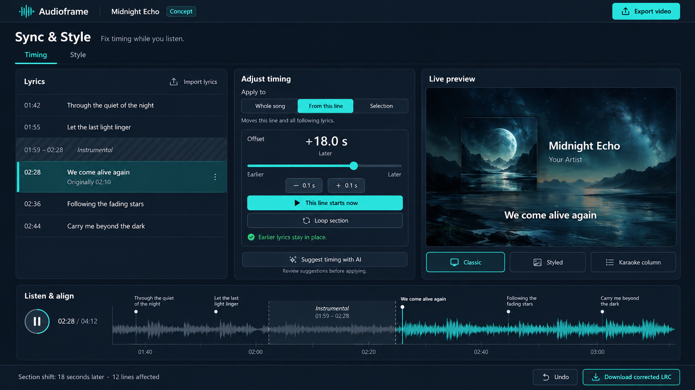

# Lyrics Sync & Style implementation plan

Status: Planned, recorded on 12 October 2026. Documentation and concept only; the feature is not implemented.

Build a dedicated page where users correct lyric timing while listening, then choose how lyrics appear in their video. The main use case is an instrumental break omitted from generated timestamps: the early lyrics are correct, but every line after the break appears too soon. Users must be able to repair that section without editing timestamp text or moving the earlier lyrics.

The page is available only when the current project's effective lyrics data is non-empty. This requirement applies to both the entry point and the page guard. Timing/style controls belong on this new page, not an expanded panel or modal in the existing editor.

This is a planned extension to [v0 product decisions](V0_DECISIONS.md). Initial delivery keeps processing local and retains the existing media, duration, resolution, and export limits. AI alignment is a separate later experiment; it does not authorize uploads or change v0's exclusion of automatic timing.

## Concept reference

The generated concept establishes the visual direction: lyric list, timing controls, live preview, and an audio timeline. It is illustrative, not implementation evidence. The actual page must include **Back to editor**; video export continues through the existing editor flow. Do not ship the concept's AI button until the later phase is available.

## Page and navigation contract

Use `/create/lyrics` as the new route, titled **Sync & Style**. Keep upload, paste, replacement, and removal in the existing `/create` Lyrics tab. Add an **Adjust lyrics** link there only when `effectivePreferences.lyricsText.trim().length > 0`, using the accepted uploaded-file content when it overrides the text preferences. A filename, a pending file selection, or a rejected upload alone does not qualify.

| Project state                                                               | Required behavior                                                                                                                    |
| --------------------------------------------------------------------------- | ------------------------------------------------------------------------------------------------------------------------------------ |
| Empty or whitespace-only lyrics                                             | Hide the entry point. Direct navigation returns to `/create` without displaying an empty adjustment editor.                          |
| Non-empty valid timed LRC                                                   | Show the link and allow timing adjustments.                                                                                          |
| Non-empty plain lyrics                                                      | Show the link, offer style controls and manual line timing. Do not invent timestamps.                                                |
| Non-empty invalid pasted LRC or metadata-only LRC                           | Allow the page to explain the issue; disable cue adjustments until usable cues exist. Offer **Back to editor** to repair the source. |
| Lyrics loading, pending settings replacement, or export running             | Disable navigation and mutation as appropriate; retain the last accepted project data.                                               |
| Lyrics become empty through removal, settings replacement, or Clear project | Remove the entry point, clear lyric adjustment state, and return an open adjustment page to `/create`.                               |
| Fresh direct visit or reload without a project                              | Return to `/create`; local media/session state is not restored automatically.                                                        |

The availability gate is a client-side project-state check, not a server-side authentication guard. Render a neutral loading placeholder until session readiness is known; do not flash the adjustment page before redirecting. Missing audio or artwork does not hide the page when lyrics exist. Explain missing media, use a preview placeholder, and disable actions that need playback. Numerical edits can remain available for valid cues; final export still requires the existing media validation.

Client navigation, **Back to editor**, and browser back/forward must preserve selected audio/artwork, preferences, accepted lyrics, corrections, playback position, and any previous generated result. Pause playback when changing pages and retain position. Do not create another audio player, analyser, export controller, or result-retention timer. Keep the existing session-only lifecycle: leaving the project subtree, closing/reloading the page, or Clear project disposes project resources.

## User workflow and page layout

1. Upload or paste lyrics in the current editor.
2. Select **Adjust lyrics** to open the dedicated page.
3. Play or seek to the problem section, select a lyric, and choose the correction scope.
4. Move the timing slider or select **This line starts now** when the singer begins the line.
5. Loop the section to check the result, then undo or refine if needed.
6. Choose a lyric template, return to the editor, and export through the existing flow. A corrected LRC download is also available on this page.

On desktop, show three panels: selectable lyric rows with timestamps, timing/style controls, and the live video preview. Put shared play/pause, seek, current-time/duration, cue markers, and a waveform below. On narrow screens, stack the preview, selected-line controls, and lyric list; keep playback reachable without horizontal scrolling. Reuse existing design tokens, controls, status messages, and keyboard focus patterns. Primary touch targets should follow the existing 44 px target.

The **Timing** and **Style** tabs are sections of this new page. Keep a persistent **Back to editor** action. Changes update the in-memory project and preview immediately; do not add an ambiguous Apply/Save step or imply persistence after reload. Keep undo/reset available. Imported source remains available for reset.

## Timing corrections

| Control               | Behavior                                                                                                                                                      |
| --------------------- | ------------------------------------------------------------------------------------------------------------------------------------------------------------- |
| Whole song            | Shift every timed cue by the chosen amount.                                                                                                                   |
| From this line onward | Shift the selected cue occurrence and all following occurrences; preserve earlier cues.                                                                       |
| Selected lines        | Shift a contiguous selected range without changing lyrics outside it.                                                                                         |
| This line starts now  | Compute the difference between the playback position and the selected cue's current start, then apply it to the selected scope. Disable without loaded audio. |
| Loop section          | Repeat a user-selected interval around the affected section; stop looping on page exit, audio replacement, Clear project, or disposal.                        |
| Undo / Redo           | Restore complete timing/style operations, including gap changes and tap timing.                                                                               |
| Reset timing          | Restore the imported baseline; make whole-song versus selected-scope reset explicit.                                                                          |

Use an **Earlier ↔ Later** slider, a numeric seconds input, and 0.1-second nudge buttons. Positive editor shifts mean **later**, negative shifts mean **earlier**. Show the affected-line count and a readable summary such as **18 seconds later · 12 lines affected**. The slider can cover a practical fine-adjustment range; the numeric input must allow larger valid corrections such as an 18-second instrumental break.

Example: the imported line begins at `02:10`, but vocals resume at `02:28`. Select it, choose **From this line onward**, then press **This line starts now** at `02:28`. This adds 18 seconds to that line and its successors while preserving the earlier verse. Show its corrected start and **Originally 02:10**.

Capture the selected cue IDs and their initial times when a slider gesture starts. Treat the gesture as one undo operation, calculating each preview from that captured state rather than repeatedly accumulating the shift. Reject edits that create negative/out-of-range times or newly reorder/collapse lyric occurrences; explain the boundary and leave the last valid state intact. Preserve imported equal-time ordering and last-occurrence lookup behavior. Do not silently clamp or reorder a user's correction.

With audio loaded, edited starts must be within its validated duration. Without audio, enforce the existing fifteen-minute limit and revalidate against the actual track when selected. Audio replacement retains corrections but revalidates them; show out-of-range issues and block export until resolved. The current loader clears the prior track when replacement starts; an explicit keep-until-accepted replacement policy would require a separate implementation.

### Instrumental gaps

Provide **Mark instrumental gap** with editable start/end positions, or positions captured from playback. Hide the active lyric during the gap and restore the correct cue when it ends. Preserve the previous lyric's start; its display may end earlier than the next line begins. Represent a gap explicitly rather than relying on low waveform energy or a delayed next cue. A waveform helps navigation but does not prove where vocals start or stop.

Reject reversed/out-of-bounds gaps and gaps containing lyric starts until the user adjusts those starts. Merge overlapping or touching instrumental intervals deterministically. Corrected LRC must reproduce gap behavior through blank cues and a restoration cue when needed; re-import must not leave lyrics blank after a gap ends.

### Plain lyrics

Plain text has no timings. Keep it static until the user explicitly chooses **Time these lyrics**. Build a working list from non-empty lines, preserve line order and the original text, and let the user stamp each line using **This line starts now**, then advance selection. Support revisiting and undoing a stamped line. Keep incomplete timing as a draft; switch the project's lyrics to timed mode only after every line has a valid start. Do not evenly distribute lines across the song or imply that existing offset controls can align untimed text.

Two-anchor timing stretch is optional later work for gradual drift: align the first and last lines of a selected section and adjust intermediate starts proportionally. It must not be part of the first release or silently enabled for section shifts.

## Lyrics templates

Templates change presentation independently of timing and the existing visual mode/layout. Switching them must retain corrections, instrumental gaps, song details, and artwork.

| Template         | Initial behavior                                                                                                                                                                             |
| ---------------- | -------------------------------------------------------------------------------------------------------------------------------------------------------------------------------------------- |
| Classic subtitle | Preserve the existing active-line appearance as the default. Keep readable wrapping, contrast, and outline/background options.                                                               |
| Styled lyrics    | Use supported bundled fonts, bounded size/color/placement controls, and a small set of deterministic fade, slide, or pop presets. Font settings affect lyrics independently of song details. |
| Karaoke column   | Show artwork/visualisation on the left and a right-side column backed by the full lyric list. Highlight the active line, dim neighboring lines, and scroll to follow playback.               |

The karaoke column displays a readable window into the full song, not every lyric squeezed into a 320p frame. Bound and clip text layout; test long lines and scripts with different glyph sizes at both output resolutions. Seeking must immediately resolve the correct active line and scroll position without depending on previous animation history. Respect reduced motion using the existing explicit rendering preference.

The first karaoke implementation highlights entire lines. Word-by-word highlighting requires genuine word timings and a separate data/parser/rendering extension; do not simulate it by distributing words uniformly within a line. Plain text can use static styles or a static lyrics column, but has no active-line tracking until timing is completed.

## State, integration, and persistence

The current [route](../app/create/page.tsx) mounts the [workspace](../components/editor/workspace.tsx), which owns preferences, accepted lyrics/media, playback, and output state. A new route must not remount a fresh independent copy of that project. Introduce a shared client session boundary under an `app/create/layout.tsx` server wrapper; keep the resource-owning audio element/controller mounted across `/create` and `/create/lyrics`. Move only the state/ownership needed by both pages, leaving page-specific rendering in focused components. Read the version-matched Next.js guidance before implementing this boundary.

Use these existing integration points; proposed new paths are implementation targets, not files that already exist:

| Area                  | Integration                                                                                                                                                                                        |
| --------------------- | -------------------------------------------------------------------------------------------------------------------------------------------------------------------------------------------------- |
| Route and page UI     | Add `app/create/lyrics/page.tsx` and focused lyrics-editor components; add the guarded link to the existing workspace.                                                                             |
| Source and cue timing | Extend [lyrics utilities](../lib/editor/lyrics.ts) with pure correction/serialization helpers and regression coverage. Preserve existing parser behavior for legacy input.                         |
| Project preferences   | Extend [editor types](../lib/editor/types.ts) with serializable lyric corrections, gaps, and template preferences. Integrate with the current layout work without replacing unrelated preferences. |
| Settings              | Extend [strict settings validation](../lib/editor/settings.ts), including compatibility/migration tests and an explicit format-version decision.                                                   |
| Preview and export    | Resolve corrections once into the shared [composition snapshot/painter](../lib/editor/composition.ts); both pages and the encoder consume the same timeline and layout.                            |
| Files and lifecycle   | Reuse [lyrics loading](../lib/editor/files.ts), `useAudioPlayback`, `useLocalFile`, `useDownload`, and the existing analysis lifecycle.                                                            |

Keep immutable imported source plus an editable canonical timeline. Each timestamp occurrence needs a stable ID; a source line number alone is insufficient because one LRC line may contain repeated timestamps. Store time in integer milliseconds. Normalize the imported LRC offset into the baseline once, following existing parser semantics; apply subsequent editor corrections to that baseline. The parser's positive `[offset:]` advances lyrics, opposite to the editor's positive **Later** shift. Do not double-apply the tag when compiling or downloading corrected lyrics.

Resolve an edit's scope to explicit cue IDs and record resulting starts, rather than retaining predicates that could change after later edits. Undo history and playback resources are session-only. Settings include source, accepted corrections/gaps, completed timings, and template preferences, but exclude selected audio/artwork, waveform buffers, object URLs, transient tap-timing drafts, and undo history.

Replacing accepted lyric content clears its corrections, selections, gaps, and drafts; preserve template choice for the new lyrics. A failed/cancelled upload retains the last accepted source and edits. Confirmed settings replacement uses the imported lyric configuration; Clear project resets everything. Retain the existing 20,000-character and settings-file bounds, and reject oversized serialized output with an actionable message.

Existing version-1 presets must retain their current Classic appearance and unmodified timing. Prefer a new settings version for the extended document with a loader migration from version 1; finalize against the effective schema when implementation starts. Do not relabel extended presets as version 1 if old strict readers reject them. Reject unsupported future versions and unknown fields as before.

Corrected LRC download writes effective `[mm:ss.fff]` starts, expands repeated timestamp occurrences, preserves lyric text/order and gap behavior, and omits the original offset tag because it is baked in. Original source remains unchanged. LRC cannot encode fonts/animations/column layouts: preserve those in settings JSON. Reparse downloaded LRC and compare its displayed lyrics against the canonical timeline.

Animations and karaoke scroll positions must derive from absolute playback/frame time in the shared Canvas painter, not DOM animation, wall-clock time, or React updates per frame. Freeze all necessary fonts and lyric state at export start. Lyrics edits update future exports; they must not modify the previous generated video's captured settings or a running export snapshot. Retain current media allocation guards; lazily calculate a bounded waveform and reuse it across pages.

## Later AI alignment experiment

Explore **Align these lyrics to the audio**, preserving supplied words rather than regenerating lyrics and guessing timestamps. Evaluate song-aware alignment against real vocals, instrumental breaks, repeated choruses, language changes, and mismatched lyrics. Treat unsupported or unmatched lines as review items, not fabricated precise timings. Keep manual section repair available regardless of AI support.

Before integration, establish measured line/word boundary accuracy, supported languages, device/model-download limits, cancellation behavior, and expected cost. Prefer local processing if usable on supported devices. A cloud option requires a separate product/privacy decision, explicit per-operation opt-in before transferring audio/lyrics, retention rules, and a supported service boundary; never embed service credentials in browser settings or code. An isolated experiment does not enable uploads in the current app.

AI suggestions remain separate from accepted timings until the user previews and accepts them. Support section-only alignment, undo, failure/retry, and stale-result rejection when lyrics/audio change. Word karaoke stays deferred until word timing quality is demonstrated. Background music and singing make alignment accuracy uncertain; see [lyrics alignment research](https://arxiv.org/abs/1909.10200) and [boundary-aware alignment research](https://arxiv.org/abs/2202.01646).

## Delivery sequence

1. **Dedicated page and session ownership:** implement the non-empty gate, guarded route, shared project resources, back navigation, and missing-media states. Verify navigation/resource lifetime before adding timing mutations.
2. **Manual sync:** implement scope selection, shift/nudge/input, stamp-current-time, loop, gaps, undo/reset, plain-text timing, and corrected LRC download. Persist accepted edits in compatible settings and feed the shared painter.
3. **Templates:** retain Classic defaults, add Styled controls and line-based Karaoke column, and verify preview/export equivalence across supported visual modes/layouts and both resolutions.
4. **AI research:** benchmark alignment separately and document results/architecture before deciding whether to build or expose it. Two-anchor stretch and word karaoke are separate follow-ups.

## Verification and acceptance

These are required future checks, not verified results:

- Test the exact non-empty gate for pasted/uploaded lyrics, whitespace, invalid LRC, pending/rejected replacements, imported settings, removal, and Clear project. Direct visits/reloads must recover to `/create` without an empty-page flash.
- Browser-test round trips and back/forward between both pages: media and preferences survive, position is retained, playback pauses, previous output remains downloadable, and no duplicate audio elements/controllers/listeners/timers are created. Leaving the project disposes resources.
- Reproduce the `02:10` to `02:28` instrumental repair: earlier cues remain unchanged and the selected/later cues move exactly 18 seconds. Check whole-song and selected-range scopes, repeated timestamps, imported equal times, offset signs, successive edits, slider gestures, undo/reset, rejected crossings, and track bounds.
- Verify gap entry/exit, loop cancellation, backward seeking, the final lyric, song end, and corrected LRC re-import. Verify plain-text drafts, incomplete timing, revisiting a line, and explicit timed-mode conversion without inventing missing timestamps.
- Round-trip new settings and migrate legacy settings. Test rejected unknown fields/versions/oversized files and failed replacement preserving the prior project. Ensure settings contain no media URLs or credentials.
- Compare deterministic preview/export frames before, during, and after cue/gap/animation boundaries, including encoder chunk boundaries and late/backward seeking. Download and play real MP4/WebM fixtures at 320p and 720p; check the instrumental correction through the final section.
- Check Classic compatibility, custom fonts/text wrapping, Karaoke scroll/highlight, static plain text, reduced motion, and supported composition modes/layouts. Test readable output rather than only DOM appearance.
- Verify keyboard operation, labeled slider/nudge controls, focus on navigation, mobile overflow/touch targets, and clear errors. Distinguish viewport emulation from physical Android/iPhone evidence.
- Run focused meaningful tests, then `bun run check` and `bun run build` for implementation. Confirm local media stays local and cancellation/replacement/disposal release waveform and playback resources.

Documentation creation does not establish runtime, AI, or physical-device readiness. Keep tasks unchecked until their corresponding implementation and verification are complete; track delivery in [TODO](../TODO.md#planned-lyrics-sync--style).
